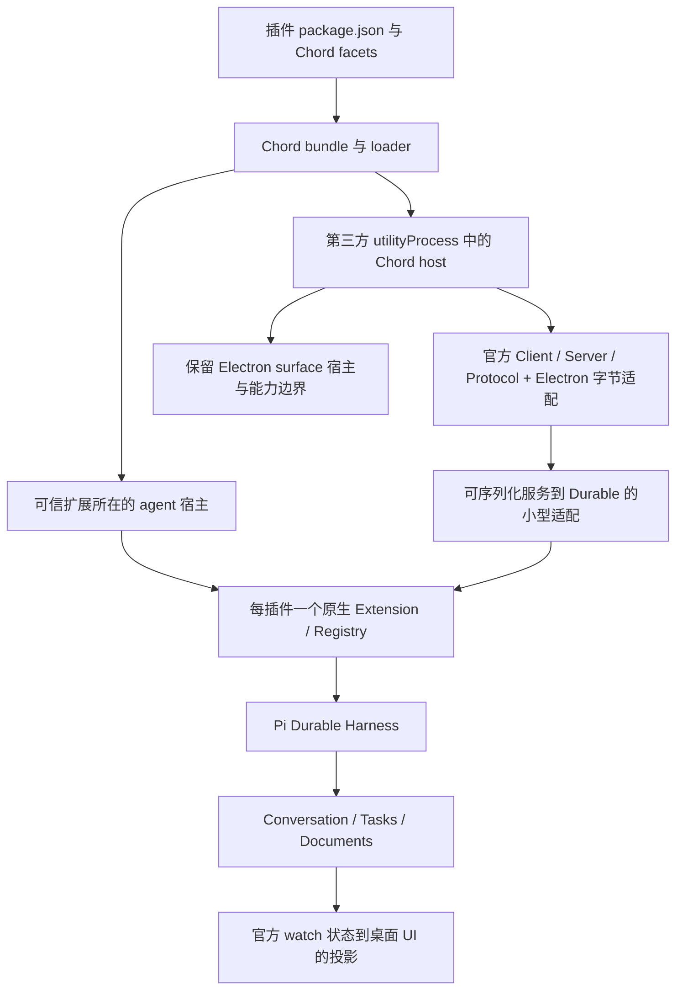

# Oint：进一步采用 Pi 官方生态的优化报告

> 2026-10-02 已获用户批准实施。最终约束：不使用 `pi-coding-agent`、`pi-tui` 或无关 CLI/TUI 依赖；取消文中 F 阶段的 coding-agent 引入选项。允许全面重构插件和其他相关代码，不保留旧代码兼容层。下文保留调研与决策依据。

日期：2026-10-02。**本轮仅调研和设计，没有修改业务代码、依赖或数据格式。** 以当前代码、正式发布的 1.0.0 包及对应官方源码为依据；不设计旧代码、旧数据兼容层。本文是下一轮重构的确认材料，不是已实施清单。

## 1. 结论和建议确认的范围

**建议继续重构，重点从“调用官方 API”推进到“由官方机制持有状态、调度和生命周期”。** 当前核心虽然已经使用 `pi-durable`，但插件、子代理、应用状态和 UI 投影仍保留相当多独立机制。只更换工具类型或 import，无法去掉这些机制。

推荐方向：

1. **插件采用 Chord + Durable**：Chord 管包加载、依赖、服务和生命周期；Durable 的每插件 `Extension` 管工具、提示段、hooks、任务。淘汰旧插件执行协议与重复注册表。
2. **优先验证官方 RPC 三包**：`pi-client / pi-server / pi-protocol` 都有正式发布的 1.0.0 API，可继续减少请求关联、取消、订阅和协议实现。先验证一条 Electron 通路，再决定扩展到哪些 IPC 域。
3. **子代理和后台编排采用原生 tasks/ownership**；todo、审批状态和报告采用 documents/memo，减少 Map、JSON 副本及手写恢复逻辑。
4. **UI 只投影一份已提交状态**，减少目前 native events → 自有 runtime events → ChatEvent → store 的重复折叠。
5. **保留真正的桌面与业务适配**：Electron 窗口/浏览器、文件和网络边界、附件字节、工作区清理、插件展示与权限规则。它们没有相应的现成 Pi 产品 API。

推荐默认保持第三方插件的进程边界、独立主聊天的物理删除，以及“后台报告更新原工具卡片、不自动唤醒主模型”的行为。愿意改变这些行为时，可以进一步减少代码，但应单独确认。

## 2. 读了什么，证据如何区分

### 官方材料

- [Pi Durable 原文](https://earendil.com/posts/pi-durable/)：完整阅读，覆盖长任务、恢复、并发会话、extensions、hooks、tasks、compaction、documents、热更新及多人视图。
- [Pi 1.0](https://earendil.com/posts/pi-1-0/) 与 [What is a Harness?](https://earendil.com/posts/what-is-a-harness/)：区分 CLI coding agent 与 durable 应用框架的定位。
- [Durable README](https://github.com/earendil-works/pi/blob/a13d35a742c6ef8462812a28fbe1d8c8b7431c32/packages/durable/README.md)、[规范](https://github.com/earendil-works/pi/blob/a13d35a742c6ef8462812a28fbe1d8c8b7431c32/packages/durable/docs/spec.md)、发布包的 exports、`.d.ts` 和对应实现。
- [后台子代理示例](https://github.com/earendil-works/pi/blob/a13d35a742c6ef8462812a28fbe1d8c8b7431c32/packages/durable/test/examples/23-subagent-background.ts)、[计划文档示例](https://github.com/earendil-works/pi/blob/a13d35a742c6ef8462812a28fbe1d8c8b7431c32/packages/durable/test/examples/27-plan-mode.ts)、[重载与重启示例](https://github.com/earendil-works/pi/blob/a13d35a742c6ef8462812a28fbe1d8c8b7431c32/packages/durable/test/examples/31-reload-and-restart.ts)。
- [官方 durable 小型应用](https://github.com/earendil-works/pi/tree/a13d35a742c6ef8462812a28fbe1d8c8b7431c32/packages/coding-agent/src/experimental/durable) 和 [vacation 示例](https://github.com/earendil-works/pi/tree/a13d35a742c6ef8462812a28fbe1d8c8b7431c32/packages/coding-agent/src/experimental/vacation) 的运行时、装配、提示和子任务代码。
- [Chord README](https://github.com/earendil-works/pi/blob/a13d35a742c6ef8462812a28fbe1d8c8b7431c32/packages/chord/README.md)，及 `pi-client/server/protocol/codemode/coding-agent` 的正式 npm 包。

发布版共同来源为 `v1.0.0` / npm gitHead `a13d35a742c6ef8462812a28fbe1d8c8b7431c32`。调研时 main 已指向后续提交，未将移动分支中的接口冒充发布版接口。Context7 返回过旧 pico 和 CLI 示例，已用发布物纠正。

### 项目范围

实际阅读了插件安装/清单/发现/进程/RPC/hooks/资源贡献/surfaces、对应 IPC 与 preload，以及 runtime、session、事件桥、子代理、jobs、todo、审批、交互、用量、provider 和资源加载代码。三个内置插件 git-status、scratchpad、toolkit 也纳入功能对照。

代码基线是本轮开始时的干净工作区；依赖仍为精确 `pi-ai/pi-durable/pi-mcp/chord 1.0.0`。此前 2702 项测试通过属于上一轮结果，**本轮没有运行优化后的验证，因为还没有实施优化**。

## 3. 官方生态的真实分工

| 组件 | 可直接使用的公开 API | 对本项目的用途 | 边界 |
| --- | --- | --- | --- |
| `pi-durable` | `defineExtension/defineTool/hook/section/wrapTool/createRegistry` | agent 扩展和工具链 | 不负责下载安装包、Electron 面板或应用服务依赖 |
| `pi-durable` | `defineTask`、ownership、`submit/requestId`、`resume` | 子代理、后台编排、恢复、队列 | 没有现成 Subagent 产品；外部副作用不自动 exactly-once |
| `pi-durable` | `defineDoc/defineDocFamily`、`tx.doc`、`memo`、`watch/viewState` | 应用状态、持久决定、UI 状态来源 | document/业务 schema 和 UI 仍由应用定义 |
| `chord` | `defineFacet/defineService/createFacetHost`、replicated state | 插件与应用服务组合 | 是通用应用组合库，不是 durable 的另一个名字 |
| `chord/bundler`、`chord/node` | `bundleFacetPackage/createFacetBundleLoader` | 官方包格式、构建、校验和加载 | 不下载依赖、不执行 npm lifecycle；VM 加载不是权限沙箱 |
| `pi-client/server/protocol` | `Client/Server/createClientServiceTransport`、字节传输与路由接口 | 官方 RPC 请求、取消、订阅、编码 | Electron transport、连接授权、业务服务仍须适配；不会自动重连和重放 |
| `pi-ai` | Models/Provider、stream、auth、模型目录 | 已经使用的模型能力 | 自定义服务设置、价格和展示仍需映射 |
| `pi-mcp` | Client、传输、取消、progress、资源、OAuth | MCP 外部工具 | 不替代任意 hooks、Node 插件或 Electron UI |
| `pi-coding-agent` 根导出 | 资源/包管理 helpers、CLI ExtensionAPI | 可选复用资源与安装能力 | 是另一套 CLI/AgentSession 扩展契约，不能直接当 durable Extension |
| `pi-codemode` | `CodemodeSandbox`、声明生成、QuickJS loader | 可选的模型脚本编排 | 不是普通 Node 插件宿主；不能直接执行工具而绕过 durable hooks/tasks |

需要纠正的几种理解：

- 文章里的 `loadExtension()`、`skills.latest()`、`agentsMd.latest()`、`askInSlack()` 是**宿主示例函数**，不是可 import 的官方 API。
- `pi-coding-agent/experimental/plugin` 和 `/client` 在 1.0.0 npm exports 中只有 `source` 条件，指向未随包发布的源码，不能作为部署入口。
- 与上条不同，独立的 `pi-client`、`pi-server`、`pi-protocol` **已经正式发布**。它们主要依赖 Chord/协议包，不要求引入 coding-agent 或换回 agent-core。
- Durable 仍标记 experimental，应继续固定版本并针对其公开契约验证；不通过 deep import 绑定内部实现。

## 4. 插件系统：建议优先重构

### 4.1 当前重复在哪里

[插件执行宿主](D:/dev/polaragent/src/main/plugins/process-host.ts)、[插件进程](D:/dev/polaragent/src/main/plugins/plugin-process.ts)、[hook 框架](D:/dev/polaragent/src/main/plugins/hooks.ts) 和 [自有 RPC 契约](D:/dev/polaragent/src/shared/contracts/plugin-rpc.ts) 实现了另一套工具发现、调用、hook 分派、请求等待、状态和失效通知。最后它们又进入 [runtime](D:/dev/polaragent/src/main/pisdk/runtime.ts) 中同一个 Oint extension。

因此目前是“自研插件运行时输出的工具使用了 native 类型”，还不是“官方扩展系统负责插件运行”。

### 4.2 拟议结构

推荐规则：

- 使用 `package.json` 身份与 `chord.facets` / `chord-facets.json`，删除旧执行清单和旧 RPC 兼容路径。面板显示名、图标、surface、授权、资源路径等只保留为产品元信息。
- 每个 agent 插件对应一个稳定命名的 native `Extension`。工具、提示段、hooks、tasks 从该扩展进入 registry；按 conversation 的 `extensions/tools` 选择。
- 内置/明确可信的扩展可以与 Harness 共处，直接使用完整 `api.commit/createTask/memo`。第三方默认保留 utilityProcess，以 Chord 服务暴露工具、提示、hook 的可序列化契约，由 agent 宿主生成原生扩展代理。
- `Extension` 含函数，`ToolExecutionApi` 含事务回调，**不能原样穿过 JSON RPC**。不再造“所有函数都能远程模拟”的第二套兼容引擎。第三方完整本地执行能力属于另一个信任选择。
- 优先用官方 RPC 三包接管 envelope、请求 ID、取消和状态订阅；应用只实现有序字节传输及服务/连接归属。先做一个真实 Electron 样本，确认总代码量和生命周期复杂度确实下降。

### 4.3 可删除或显著缩减的职责

| 当前职责 | 替代方式 | 仍保留什么 |
| --- | --- | --- |
| init/ready/call/hook 协议、pending 请求、目录分发 | 官方 RPC + Chord 服务 | Electron MessagePort/utilityProcess 字节与关闭适配、timeout 策略 |
| 插件工具运行表、工具版本号、手写 hook chain | 每插件 Extension + registry publication + native hooks | 命名空间、权限顺序、工具暴露预算 |
| 手写模块加载/依赖激活/资源释放 | Chord bundle/loader/facet host | 包获取、安装目录、应用资源与错误展示 |
| `pendingPluginContext` 等一次性可变变量 | 按插件/调用组织的 document、memo、section/beforeRequest | 提示注入的产品策略 |
| 四工具 toolkit 的 gateway/catalog 包装 | 原生 `defineTool` 精确 schema | hash/encode/uuid/time 的业务函数 |
| 多份资源贡献快照与手动 generation 对账 | 统一插件服务状态和 registry 发布 | `.agents/skills` 等资源优先级、MCP 配置的来源和授权 |

**不要直接删除所有 gateway。** Durable 支持动态 registry，但不会自动提供大型工具目录搜索。内置 toolkit 可直接注册四个工具；拥有数百工具的 MCP server 是否聚合，仍需按上下文预算决定。

### 4.4 热更新与隔离不能省略的细节

- Chord `FacetHost.reload()` 只替换已有 facet ID，且服务依赖/提供形状必须一致。新增、停用、删除插件应建立/销毁对应 host 或通过固定的 keyed service 发布，不能调用一次 `reload(allEnabled)` 解决。
- 候选 facet 激活成功前不要发布新 extension；旧代释放不能无条件 `registry.uninstall(oldExtension)`，因为该调用按名称删除，可能把刚安装的新代删掉。应由一个发布者管理切换或核对当前对象身份。
- 已在运行的工具保留旧 JS 实现，新调用采用新实现；但 registry 不会替应用保活旧 utilityProcess/远程连接。若保持不中断调用，仍需一层按调用归属排空旧实例的机制；不能删除所有 generation/生命周期逻辑。
- 自定义 task 有持久 checkpoint 和定义版本。新代码版本不兼容且没有 `migrate` 时，旧的在途任务可能被阻塞或 migration_failed。无需旧数据兼容不等于可以忽略正在运行的任务；默认不兼容更新前排空或取消相关任务，不承诺无条件热换。
- 第三方远程 hook 默认保持当前观察/阻止语义。开放原生改参时，宿主审批必须在参数改写之后执行；memo 应绑定最终工具名和规范化参数，避免重试换代码后沿用针对旧参数的批准。
- 当前 utilityProcess 是进程故障和环境隔离，**不是完整 OS 权限沙箱**；Chord 的 `node:vm` loader 也不是。删除进程边界会改变故障范围与凭据可见性，需要明确确认。

### 4.5 现有插件体验的去向

- **git-status**：保留 Git 面板与受限执行能力；服务通道可以统一，界面不是 Durable 替你提供的。
- **scratchpad**：保留速记模态框、私有存储和剪贴板。它是跨会话数据，不应硬塞到 conversation doc；Chord replicatedState 也不等于持久数据库。若统一应用持久化，可用独立的应用级 durable storage、`createSession` 与 session-scoped document 保存插件私有状态，不依附某条聊天；应衡量新增存储 owner 与替掉现有短 KV 实现的成本。
- **toolkit**：最适合首个 native facet/Extension 样本，删除内置 `main.cjs` 中的协议循环。
- 保留安装、启停、重载、卸载与“保留数据”的 UI。可继续分发预构建 ZIP，但解压/路径校验仍是应用边界；不默认新增在线市场或执行 npm 安装脚本。
- 保留 surface 的 CSP、来源检查、文件/网络/执行/剪贴板授权。用官方 service 可以减少协议，不能代替执行端检查。

## 5. 子代理、应用状态和 UI：另一组高收益替换

| 领域与当前代码 | 优先使用的 API | 拟减少的自研内容 | 必须保持的语义 |
| --- | --- | --- | --- |
| [子代理运行器](D:/dev/polaragent/src/main/pisdk/subagent-runner.ts)、[Task 工具](D:/dev/polaragent/src/main/pisdk/tools/subagent.ts) | `defineTask`、task-owned Conversation、background ownership、`waiting/outcomes`、`watchTaskGraph` | 运行 Map、promise 状态机、独立子库、索引副本和重启猜测 | 当前立即返回、并发/轮次上限、工具白名单、父新输入取消旧委派、不自动唤醒父模型 |
| [Todo](D:/dev/polaragent/src/main/pisdk/tools/todo.ts) 与 runtime 恢复扫描 | `defineDoc({history:"rewindable",fork:"asOf"})`、`tx.doc`、`documentState`、section | 内存 todo + custom entry 双写、回放扫描、手动分支恢复 | 整表替换、revision、任务 ID 和截止点状态；重跑不重复增 revision |
| [审批](D:/dev/polaragent/src/main/pisdk/approvals.ts)、[提问](D:/dev/polaragent/src/main/pisdk/interactions.ts) | `api.memo`、待决请求 document/task、稳定请求 ID | 重启即丢失的决定、重复询问、部分 pending 状态机 | AI 预审、用户按钮、always-allow、拒绝、deadline、取消和重复点击幂等 |
| [事件桥](D:/dev/polaragent/src/main/pisdk/runtime-events.ts)、runtime 与 renderer stores | `Conversation.watch/viewState`、Chord state/ops | 两级事件重建、重复流式输出/队列缓存、手动猜消息与 entry 对应 | 首次/重连快照、增量显示、慢消费者重置、附件映射、assistant-ui 适配 |
| [会话索引](D:/dev/polaragent/src/main/pisdk/sessions-index.ts) 与配置副本 | native AgentDoc + app documents | cwd/model 的重复权威值、每项状态单独 JSON 双写 | 跟随默认与显式绑定的区别、标题/归档/置顶；多库目录仍可有可重建索引 |
| [用量](D:/dev/polaragent/src/main/pisdk/session-stats.ts)、[统计汇总](D:/dev/polaragent/src/main/stats/usage-stats.ts) | `UsageDoc`、`Harness.usage()`、提交后的派生统计 | 多处总 token/cost 累加与不一致快照 | 失败/中断/压缩花费、工具 usage、不重复记 fork 历史；TTFT/日期图另保留 |
| [后台作业](D:/dev/polaragent/src/main/pisdk/jobs.ts) | native task、checkpoint、abort、document、taskGraph | 作业生命周期/状态的独立 Map 与调度 | 真实进程、日志文件、Windows 终止、输出游标；不能自动恢复已断开的 PID/pipe |

### 子代理不是把官方示例整段复制进来

文章明确没有内置 Subagent 类型。官方示例可替掉调度基础设施，但角色定义和业务策略仍由 Oint 决定：

- 普通 task-owned 前台子会话会参与父任务的完成和取消；当前 Task 是后台派发，必须采用 background anchor task 等对应结构。
- 示例中的 reporter 会提交 follow-up。Oint 当前的行为是更新原调用卡片，模型通过 `TaskWait/TaskList` 主动读取；不要因此引入自动多跑一轮。
- `allSettled/failFast` 不是 `minCompleted/any/timeout` 的全部等价替代，保留少量策略适配，删除独立调度器即可。
- taskGraph 只展示活任务。已完成的报告和运行历史需要 document/任务查询，不能随图中节点消失而丢失。

### 一个需要纠正的现状

当前 `deliverJobResult/deliverSubagentReport` 的卡片回填只修改 UI 内存 part 并发 IPC，不是 native transcript/context 提交。不能根据旧注释认为“模型下一轮自动看到了报告”。建议让卡片和读取工具共同读取 durable document；若将来需要自动注入模型上下文，再明确使用 section/beforeRequest 的策略。

### 状态视图和完整历史是两种数据

`ConversationView.entries` 是当前 active context，压缩前的完整历史仍在 storage。新 UI 可以由 watch 的已提交状态驱动运行、队列和当前输出，但历史分页不能删除。renderer 对 assistant-ui 的展示转换仍存在，只应消除第二份运行时权威状态。Chord 发布值按只读所有权使用，UI 不应就地修改收到的权威快照。

### 持久化不等于外部副作用自动安全重放

`requestId` 对提交去重；`api.memo` 对任务中的决定采用首次写入；自定义 document commit 与最终工具结果不是自动合成一次提交。它们都不自动保证发消息、部署或任意 shell 命令只执行一次。

后台命令跨进程崩溃后，原有 pipe 无法凭 `resume()` 接回。默认保存状态/日志并明确 interrupted，不能统一设置 `replay:"safe"`。真正需要可接回进程时必须有外部 supervisor，那属于额外需求。

## 6. 会话布局：不用“全应用一库”换取表面上的零适配

当前每条主聊天一个文件；内部重试已用 native fork，外部“另建聊天分支”仍复制历史、重映射 ID 并处理附件。

**默认建议：一个主聊天及其子代理、内部重试共享一个 Harness/storage。** 这让子代理获得原生 ownership、原子提交和恢复，同时保留独立主聊天的文件级管理边界。

公开 1.0.0 API 没有单 conversation 的物理删除或独立导出。外部新聊天分支有两种选择：

| 选择 | 收益 | 代价 | 建议 |
| --- | --- | --- | --- |
| 外部分支也共享原库，全部 native fork | 删除历史复制和 ID 重映射，分支成本小 | 单聊天删除变成隐藏/软删除；共享祖先、附件、整库清理和导出需重新定义 | 仅在接受行为变化后采用 |
| 独立聊天仍独立文件 | 保持单聊天物理删除、独立导出与清理 | 外部 fork 仍需一层 snapshot copy；子代理和内部 retry 已可全部原生 | **本次默认推荐** |

不通过手改 durable 内部 SQL 删除 conversation，也不深挖内部 schema 模仿未公开 API。附件字节和用户工作目录无论选哪种都需要应用所有权规则；原生 fork 不替你移动文件。

## 7. 资源与插件包：确实有官方 API，但需要衡量依赖成本

`pi-coding-agent` 的**公开根导出**包含：

- `loadSkills/loadSkillsFromDir/formatSkillsForPrompt`、`loadProjectContextFiles`、frontmatter helpers。
- `DefaultResourceLoader`，可以取 skills/prompts/context 等资源快照。
- `DefaultPackageManager`，支持 npm/Git/本地包的解析、安装、移除和更新。

官方 durable 小应用也借用了部分资源 helpers。因此不能把 [resource-loaders.ts](D:/dev/polaragent/src/main/pisdk/resource-loaders.ts) 全部说成“没有 API 可替代”。

**推荐纳入独立验证选项，而不是直接整包替换：**

1. 从公开 root 复用需要的 helpers，并将结果接入 durable section。验证同名覆盖、共享技能目录、项目信任、禁用规则、ASAR 路径等实际行为差异。
2. 测量 Node 导入、启动时间及 Electron 产物。该 root 有静态 re-export，依赖包括 `pi-agent-core/pi-tui/pi-codemode`、图像/QuickJS 等；不是只引入几个纯函数。重新出现 **1.0.0** agent-core 依赖不算回退，但不得再宣称整个项目不含它。
3. 不能通过 `dist/core/...` deep import 或复制上游实现来假装使用公开 API。
4. PackageManager 不认识 Oint 的旧清单，也不自动理解 Chord facet；可用于获取包根，再交 Chord 加载，但仍需映射。
5. 其 npm 安装调用没有默认 `--ignore-scripts`，会改变当前只安装/解压包的执行行为。在线安装应单独确认，不夹带在“等价优化”里。

**不建议引入 `ExtensionRunner` 实现全部 Pi CLI 插件兼容。** 它依赖 SessionManager、CLI context 和 TUI 等契约，包装回 Durable 会产生另一套兼容引擎，与本次目标冲突。现有 CLI 插件即装即用不是本次默认承诺。

## 8. 哪些保持现状，哪些是可选扩展

- 模型流、provider 接入、MCP 协议、原生 bash/edit/write、基础 compaction 已经采用官方 API。保留薄配置/权限/展示适配，不再为减少文件数反复重写。
- BrowserWindow/webview/CDP、PTY、网页抓取和搜索后端、附件解码/文件复制没有完整等价的 Pi 产品 API，保留业务实现，用 native tools/services 暴露。
- 时间序列统计、TTFT、解码速度不是 UsageDoc 提供的；成本目录对用户自定义服务默认 0 时，官方 usage 也不会知道真实价格。
- `UsageDoc` 自身采用 `fork:"initial"`，原生分支不会继承费用账本。防止重复计费的工作主要针对应用跨会话汇总、历史消息扫描和日期派生索引，不是修补原生 fork 账本。
- MCP OAuth、资源浏览器、Codemode 脚本编排属于可选新增能力，不与“减少现有自研代码”混为一谈。特别是 Codemode 不能通过直接调用 `tool.execute` 绕过 durable 的权限 hook 和持久任务边界。

## 9. 源码中发现的待验证问题

以下来自本轮代码阅读，**没有将其表述为已执行复现的故障**。实施时应先加行为验证，再删除对应旧机制：

| 位置 | 当前事实/风险 | 原生方向 |
| --- | --- | --- |
| runtime 插件 PreToolUse 分支 | 处理 block/failures，没有使用约定的 additionalContext | 按插件的稳定 section/request 投影 |
| runtime `pendingPluginContext` | 单值写入可能覆盖同轮多工具上下文，beforeRequest 消费后重试未必仍在 | document/memo 派生请求上下文 |
| process-host 的 signature | 只包含工具名，未如注释所说包含 description/schema | registry 发布与可序列化目录版本 |
| plugin-process 请求等待 | 本地超时结算，没有取消插件执行 | 官方协议 cancel → service Context → 实际操作响应 |
| 插件/surface 契约 | 存在未落实执行点的权限字段及保留事件 | 删除未实现声明或真正接线，不搬运空协议 |
| 后台卡片回填 | UI 结果不等于 durable/context 结果 | document 是权威来源，卡片/工具统一读取 |

## 10. 规模基线和实际删减目标

物理行包含注释和空行，排除测试；**不是可删除行数，也不是预计节省比例**。

| 范围 | 当前规模 |
| --- | ---: |
| main/plugins 生产文件 | 21 个文件，5743 行 |
| 插件相关 main + contracts + IPC + preload + renderer 子集 | 38 个文件，9885 行 |
| 三个内置插件资源 | 9 个文件，1263 行 |
| runtime / runtime-events | 3206 / 396 行 |
| subagent-runner / tools/subagent | 614 / 749 行 |
| session-store / durable-session / sessions-index | 887 / 408 / 99 行 |
| jobs | 671 行 |
| approvals / interactions / todo | 307 / 163 / 282 行 |
| resource-loaders | 185 行 |

重构完成应以这些结果衡量，而不是强行删掉某个百分比：

- 不再存在旧插件 init/call/hook 协议和独立 hook chain。
- 子代理运行事实不再同时存在于 Map、JSON 索引和 native task 三处。
- Todo/审批/报告有唯一 durable 状态；UI 重连不依赖先前收到的事件序列。
- tool/schema 更新通过官方 registry/service 发布生效，不维护多个手写 generation 信号。
- 核心模型/任务/队列/用量以原生记录为准；剩余代码能明确归类为业务规则、桌面适配或可重建投影。

## 11. 建议实施顺序与门禁

| 阶段 | 具体交付 | 验收后才能删除的旧内容 |
| --- | --- | --- |
| A：官方边界样本 | toolkit 的 Chord facet + native Extension；一个 MessagePort 上的官方 Client/Server 服务，覆盖调用、取消、状态订阅、ASAR | 确认该路线可部署，且新增适配少于替掉的协议；不是整个项目先改 RPC |
| B：插件原生化 | 每插件扩展、Chord 加载/依赖/生命周期、受控热替换；保留三个内置插件功能与第三方进程边界 | 旧执行清单、重复注册/工具版本、PascalCase hook 框架、自研 RPC 通用层 |
| C：任务与状态原生化 | 主聊天家族 Harness、后台子会话、documents/memo、持久报告与审批/提问 | 子代理手写状态机、运行索引副本、todo 回放、丢失决定的 pending 机制 |
| D：视图与用量收敛 | watch/viewState → 单一 UI 投影；native usage + 可重建统计 | 双层事件折叠、重复 output/queue/token 权威缓存；保留完整历史分页 |
| E：后台作业 | native task/document 管生命周期，进程与日志适配明确 | 可替代的 job 状态和调度；不删除实际 OS 进程管理 |
| F：可选资源/包管理 | public coding-agent helpers 对照实验、启动/包体/行为成本记录 | 用户接受取舍且实验有净收益后，再删除资源重复解析或包获取代码 |

B/C 可在接口约定后并行；C 的 documents/state 是 D 的基础。A 的完整 RPC 验证失败不阻止 C/D 的确定收益，也不以引入更多包本身当作优化。

必须通过的真实行为验收：

- 插件安装/启停/热更新/崩溃/卸载，服务增删和形状变化，取消传到真正执行端；旧调用结束、新调用用新版本，旧代清理不删新代。
- 主聊与并行子代理各自模型、cwd、工具权限、上限；杀进程后无重复孩子/重复输入；前后台取消范围和报告策略保持。
- Todo 分支按截止点恢复；审批/回答提交前后重启与重复点击只有一个有效结果；外部副作用不因重跑重复执行。
- 视图首次挂载、断线重连、超过缓存上限重置、压缩与重试、完整历史和附件都一致；无重复消息/工具卡。
- 用量覆盖失败、取消、压缩与工具支出，分支历史不重复计费；性能指标和日期口径保留。
- 独立聊天删除、共享工作区、分支附件、Windows 进程终止，以及 Electron 沙箱 preload/ASAR/Chord bundle/peer externals。

## 12. 请确认的决策

**建议批准 A–E，按阶段交付；F 单独验证后再决定是否引入依赖。** 默认选择如下：

| 决策 | 推荐默认值 | 需要明确同意才改变的选项 |
| --- | --- | --- |
| 插件作者格式 | 新 package.json + Chord facets；不保留旧 Oint 执行格式 | 完整兼容所有 Pi CLI 插件会是另一项工程，不纳入 |
| 第三方执行 | 保留 utilityProcess，以官方服务/RPC 提供可序列化能力；可信内置扩展使用完整 native API | 第三方直接进入 agent 宿主，换取更少代理代码和完整 API，同时改变隔离 |
| 聊天/分支存储 | 主聊+子代理+内部重试同库；独立聊天仍可单独物理删除 | 外部聊天分支也同库，接受单条软删除和共享清理 |
| 官方 RPC | 批准 Electron 样本验证，通过后用于插件和需要收敛的内核服务 | 不默认一次性替换浏览器、终端、系统窗口的全部 IPC |
| 资源 API 依赖 | 做 public helpers 的成本/行为对照，再决定引入 coding-agent | 不默认新增 npm lifecycle 执行、在线市场或 CLI 兼容层 |

确认本报告之前，不开始上述实现。上述方案已完成一次独立的源码/API 复核，热更排空、任务版本、审批参数绑定、RPC 成本与原生用量分支语义的复核意见均已纳入；这不替代实施后的行为验收。
