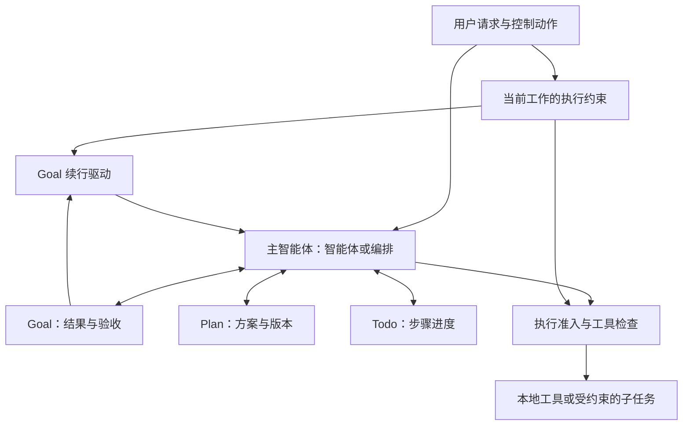

# Oint 计划能力重构报告

调研日期：2026-10-03。依据：当前工作区实现（含尚未提交的修改）、OpenAI 官方文档、DeepSeek Harness 的公开文档与计划子系统源码。本报告提出设计，不表示已完成实现或运行验证。

**建议：彻底移除独立计划模式，将计划建设为与目标并列、在智能体和编排中均可使用的持久化能力。** 同时拆出通用的执行约束，使“只给方案”“先确认再执行”“直接执行并动态调整计划”都能成立。

按项目要求，不保留旧接口、旧计划文件格式、旧模式值或兼容分支。也不把旧模式改名成另一个全局 `planning: boolean`：计划是否存在，不应决定整个会话能调用什么工具。

**1. 从参考项目中借鉴什么**

| 维度 | Codex：已核实的行为 | DeepSeek Harness：已核实的行为 | Oint 建议 |
| --- | --- | --- | --- |
| 产品入口 | `/plan` 仍是计划模式入口；可先规划，再用 `/goal` 设定持续目标 [1][2] | `/plan`、`/plan off` 和 `exit_plan_mode` 管理计划协作状态 [4][5] | 移除模式入口；提供“制定计划”“修改计划”“执行此版本”等动作 |
| 方案与步骤 | App Server 分别提供方案正文 `plan` item，以及 `{step,status}` 形式的 `turn/plan/updated` [3] | 评审接收完整 Markdown 方案；原文保留于调用日志 [5] | Plan 保存方案与取舍，Todo 保存动态步骤进度 |
| 与权限的关系 | 协作模式、沙箱和审批在协议中分别表达 [3] | 明确声明计划是软性指引，工具仍可用，沙箱和审批独立强制限制 [4][6] | 计划服务不授予或撤销工具权限；通用执行策略负责落实用户约束 |
| 评审 | 官方文档支持“先调查和提案，再编辑”的使用方式 [2] | 用户可批准或反馈；批准从后续步骤生效，当前工具批次不切换指引 [5][6] | 仅在用户要求确认时设置评审关口；明确版本、作用域和生效边界 |
| 持久状态 | 官方产品文档将 Goal 描述为持久目标 [1] | 计划状态可恢复；Goal 状态、工具、命令、自动续行分离 [4][7][8] | Plan、用户控制、执行准入、Goal 续行分别负责各自职责 |

这里的结论是 Oint 的设计选择。**两家参考产品目前都仍有计划模式，不能把“取消计划模式”描述为它们已经采用的方案。** Codex 的两类计划事件证明了表示层的区分，并不等于其公开文档承诺了所有计划工具在所有模式下可用。

DeepSeek 最值得借鉴的是职责划分，以及保持工具注册稳定、在步骤边界应用状态变化的做法；它的计划状态主要是 `active/pending`，并不是现成的完整计划文档服务。Oint 应按自身需求设计持久方案，而非照搬其开关。

**2. 当前实现的耦合在哪里**

| 当前事实 | 影响 |
| --- | --- |
| `AgentMode` 包含 `standard / orchestrate / plan`；计划模式有独立系统提示与工具白名单 | 工作方式与执行权限混在一个枚举里 |
| `save_plan` 在工具实现和运行时两处要求 `mode === "plan"` | 普通执行中无法正式保存计划，也无法自然重规划 |
| `PlanState.returnMode`、`RunModeDoc.returnMode`、运行时 `planReturnMode` 配合使用 | “执行计划”还要保存、恢复和回滚会话模式 |
| `startPlan` 同时校验文件、领取版本、切模式、提交执行与失败回滚 | 一个业务动作承担过多跨层职责 |
| `invalidatePlan` 通过普通输入修订号把已就绪计划改回草稿 | “解释第三步”和“删除第三步”不能被区别对待 |
| 计划正文位于外部 Markdown 文件，状态保存路径与哈希；文件面板有专门的计划读取通道 | 查看、fork、文件完整性与执行确认互相牵连 |
| Goal 的启用、恢复、续行多处读取计划模式或草稿/就绪状态 | 即使仅保存参考计划，也可能干扰目标推进 |
| Todo 已是多步工作的执行清单，但计划类型还包含 `executing/completed` | 容易形成多套进度；当前所查流程有 `executing` 写入，没有计划完成闭环 |

依据：[模式契约](D:/dev/polaragent/src/shared/contracts/common.ts:17)、[计划门禁](D:/dev/polaragent/src/main/pisdk/plan-mode.ts:5)、[工作流类型](D:/dev/polaragent/src/shared/contracts/workflow.ts:16)、[计划工具](D:/dev/polaragent/src/main/pisdk/tools/workflow.ts:94)、[计划失效和领取](D:/dev/polaragent/src/main/pisdk/workflow.ts:57)、[运行时](D:/dev/polaragent/src/main/pisdk/runtime.ts:2086)、[Todo](D:/dev/polaragent/src/main/pisdk/tools/todo.ts:70)、[文件读取](D:/dev/polaragent/src/main/ipc/files.ts:45)。

现有实现仍有应保留的正确语义：版本核验、幂等重放、执行准入、取消后回滚、用户输入优先、手动暂停不可被自动恢复。这些是新设计的正确性要求，不是必须沿用的旧代码。

**3. 目标结构：能力、执行约束、调度分开**

| 对象 | 回答的问题 | 不应承担的职责 |
| --- | --- | --- |
| Goal | 最终要达成什么，如何验收 | 不保存详细方案，不直接调度工具 |
| Plan | 准备如何完成，为什么这样做，有哪些约束和取舍 | 不代表执行授权，不维护另一套实时步骤进度 |
| Todo | 当前做到哪一步，下一步是什么 | 不代替方案，也不证明目标已经完成 |
| Task | 哪项工作委派给谁，结果如何 | 不自行扩大主任务的执行范围 |
| 执行约束 | 本次工作允许产生哪些效果，是否需要先评审 | 不通过 `plan` 是否存在来推断权限 |
| 续行驱动 | 当前工作结束后是否应再安排一轮 | 不生成目标，不批准计划，不恢复用户暂停 |



计划可以单独存在，也可通过 `goalId` 关联目标；目标可以没有正式计划。简单任务继续直接处理。计划的完成产出也可以就是一份研究、旅行或写作方案，不应默认意味着后续要执行它。

保留智能体与编排两种现有工作方式。本次不顺带决定是否合并编排模式。

**4. 统一交互，但不强制每项任务经过确认**

| 用户请求 | 应有行为 |
| --- | --- |
| “修复这个问题” | 已授权的范围内直接处理；按复杂度选择 Todo、Plan、Goal，不强制展示计划卡或等待确认 |
| “先制定计划，然后完成重构” | 制定方案后继续执行；不因调用计划工具额外插入确认 |
| “只给计划，暂时不要修改” | 研究并保存方案；执行约束禁止实施，交付后结束当前工作 |
| “计划给我确认后再做” | 形成指定版本并等待评审；确认前不实施相关工作 |
| “把第二阶段改成离线处理” | 修订方案和关联需求；若改变已确认的实施范围，对受影响部分重新确认 |
| “解释一下第三步” | 解释现有方案，不自动生成新版或撤销已有效的授权 |
| “执行这份计划” | 在版本、当前约束和用户授权明确时提交执行，不切换工作方式 |

“仅规划”应记录为**当前工作的持久约束**，在这项工作的后续输入、上下文压缩和重开后继续有效。它不是全会话的计划开关；用户提出另一项独立工作时应有独立作用域，不被旧计划锁住。

最小实现只需要当前工作标识，以及可选的 `goalId / planId` 关联；无需借此引入复杂的多工作流编排系统。

入口建议：输入框动作菜单提供“制定计划”，效果是发送带“仅规划”约束的请求；计划卡提供“查看”“修改”“执行此版本”“归档”。若保留 `/plan`，它应是一次性请求动作，不再有 on/off 状态，也不叫“切换计划模式”。

**5. 计划数据以原生持久文档为准**

建议新建 `PlanDoc`，使用项目已有的 `defineDoc`、事务、历史快照和 fork 机制。计划正文直接存入文档；独立 Markdown 文件只作为按需导出的产物，不再参与执行准入。

最小数据形状如下，字段名是建议，并非已实现 API：

```ts
type Plan = {
  id: string;
  revision: number;             // 方案内容版本
  requirementsRevision: number; // 已纳入的需求版本
  goalId?: string;
  title: string;
  markdown: string;
  status: "draft" | "ready" | "archived";
};

type PlanRef = { planId: string; revision: number };
```

正文记录目的、范围、实施思路、关键取舍、依赖、风险和验证方法。根据任务类型调整内容，不强制每份非编码计划填写文件名、测试命令或回滚方式。

`ready` 只表示方案已形成，不表示获批。评审结果与执行授权记录在当前工作的控制记录中，绑定 `PlanRef` 和约束版本；执行状态属于运行记录。界面可据此显示“待确认”“执行中”等组合状态，不再向 Plan 填入难以独立维护的 `executing/completed`。

具体存储规则：

- 当前内容只有 `PlanDoc` 一个事实来源，历史版本由原生历史保存。所有内容修改形成新版本，不原地改变已评审版本的含义。
- 执行请求绑定明确版本；准入时冻结该版本正文与约束快照，后续保存不会悄悄改变已开始的执行。
- fork 继承可查看的方案内容与用户限制，不继承有效的执行领取、自动续行许可或跨工作区实施授权。
- 重开可恢复方案和评审记录，但不因此自动启动工作。压缩后注入当前方案摘要、版本与约束，完整正文按需读取。
- 先提交持久状态，再发布界面变更。失败的保存不出现“可执行”卡片；导出失败只影响导出。
- 正文设置合理大小上限，不能把仓库文件和大段工具日志全部塞入 Plan；详细证据继续引用原始产物。

此设计去掉了运行时对计划文件路径、真实路径和文件哈希的依赖；它并不取消访问控制。读取指定方案仍要核验会话及工作归属。

**6. 模型工具与用户控制使用同一服务**

建议模型侧提供三个小工具：

| 工具 | 职责 |
| --- | --- |
| `read_plan` | 读取当前或指定历史版本，返回相关需求修订与评审状态 |
| `save_plan` | 新建或修订完整方案；更新时要求计划 ID、预期版本和需求修订号；事务中核验并保存 |
| `present_plan` | 将已保存的明确版本发布为可查看卡片；若当前工作要求评审，建立或复用该版本的待评审请求 |

三个工具在智能体与编排中均可用。`present_plan` 不自动执行，也不必阻塞工具调用等待用户；持久的卡片与用户控制事件可跨回合、重开使用。模型不得通过参数把“需要用户确认”改成“不需要确认”。

用户侧的查看、修改、执行、拒绝和归档通过同一个 Plan 服务与执行准入服务处理。没有必要暴露 `enter_plan_mode / exit_plan_mode / switch_to_execution` 一类工具。

主 AI 管理会话正式方案；子智能体可以读取主 AI 显式提供的方案版本并返回建议，首版不允许它们并发修改正式 Plan。是否委派由原有策略决定，计划能力本身既不自动委派，也不一律禁止委派。

Todo 保持动态步骤的唯一来源。有方案时，Todo 可增加可选的方案引用；方案的阶段描述无需复制实时完成状态。普通步骤推进不反复改写完整 Markdown，也不重复触发评审。

**7. 执行约束必须通用，且覆盖实际执行路径**

删除 `allowedInPlan` 后，替代机制应检查“本次工具调用能否符合当前工作的约束”，而不是把相同白名单搬到 `if (hasPlan)` 分支下。

可以将工具效果初步分为：读取、应用内方案元数据写入、工作区写入、外部系统变更、无法确定的效果。最终放行是用户授权范围、当前工作约束、应用权限策略和执行环境限制共同满足的结果。

由此得到的行为：

- 用户只要方案时，允许检索、提问和保存应用内方案；不允许实施修改。
- 已授权实施时，保存或更新 Plan 不影响正常工具使用；应用原有权限检查继续生效。
- 任意 shell 命令不能只凭字符串以 `git`、`cat` 等开头就认定只读。优先用语义明确的读取工具；开放 shell 需依赖能够实际执行限制的环境。
- 插件/MCP 自报的只读标记不能单独构成保证。使用宿主掌握的工具描述与约束；效果未知时，不在受限工作中直接放行。
- 除工具入口外，还要覆盖插件钩子、后台任务、浏览器、恢复任务和子任务。没有可靠约束手段的进程内插件钩子，在受限运行中暂不加载；不能只检查工具后宣称全面只读。
- 子任务继承父工作的约束上限；子任务自身授权只能进一步收窄。Goal 续行沿用同一约束，不因新一轮运行恢复更大权限。

工具注册表可以保持稳定，运行时统一检查；可按实际约束裁剪模型可见工具以减少无效调用，但不再因“存在计划”反复重装整个工具目录。缓存收益需要测量，不作保证。

这是本次完整重构中必要的一层。若仅删除旧门禁并依赖“不要写代码”的提示词，可以实现软性规划，却无法继续兑现当前产品“仅规划时禁止实施”的行为。

**8. 授权、修订与并发的边界**

计划内容不是授权书。保存计划、Goal 处于 active、Todo 出现下一步，都不能单独启动实施。

默认不追加确认；当用户已要求“完成任务”，执行约束在原授权范围内允许推进。用户明确要求先评审时，执行依据必须来自真实用户控制：卡片、命令，或能够明确绑定到当前方案的用户消息。

自然语言不能只匹配“可以”“继续”就解除限制。处理器需保留原始消息 ID、所指方案版本与解释后的动作，并通过统一准入；“继续完善计划”与“按第 3 版开始实现”必须区分。若含义不清，继续澄清，不能让 `save_plan` 自行设置批准。自然语言解析仍有判断误差，结构化按钮提供最确定的版本绑定路径。

| 情况 | 处理规则 |
| --- | --- |
| 解释、询问进度等不修改方案的输入 | 不自动提高方案版本或撤销授权 |
| 新输入明确修改需求或方案 | 先标记该工作的待处理修订，阻止旧版本被新领取；纳入后提高需求版本 |
| 尚不能确定输入是否影响实施 | 先保留待处理状态，处理完再决定；不能让自动续行抢先使用旧范围 |
| 已有强制评审要求，方案正文发生修改 | 原批准不覆盖新版；首版采用整版重新确认，暂不做自动“语义等价”放行 |
| 普通执行中调整已授权范围内的步骤 | 更新 Todo 或 Plan 后继续，不把正常重规划变成反复确认 |
| 评审通过与同批工具调用并发 | 放宽限制从新的执行准入边界生效；当前工具批次沿用原约束 |
| 用户收紧范围或停止工作 | 立即停止安排受影响的后续工具与子任务，并取消可取消的工作；已发生的副作用不能声称被撤销 |
| 重复点击执行、网络重试、工具重放 | 同一控制请求使用幂等键；相同领取只对应一次执行，已受理结果可重复返回 |
| 领取后、提交前取消或失败 | 释放预留，保留可重试方案；不遗留执行中状态或授权提升 |
| 已提交后应用重启 | 从原生收件箱和运行记录识别既有请求，不再创建第二次实施请求 |

`requirementsRevision`、方案内容版本、运行记录、控制授权不能共用一个总修订号。无关的 Goal 进度更新不应使正在查看的方案失效。

授权处理和执行提交若不能处于同一原生事务，使用持久预留加唯一请求 ID：重启后核对收件箱是否已受理，再恢复或释放预留。不要用界面的“按钮已经点过”作为执行恰好一次的证明。

**9. 与 Goal 续行的组合**

计划服务不增加自己的自动执行循环。唯一的 Goal 续行驱动至少同时检查：目标仍有效、续行已启用、当前工作约束允许本轮推进、无待处理评审或相关需求变更、没有优先用户输入、运行已空闲且额度足够。

两个容易混淆的场景需要明确：

- 如果 Goal 是“实现功能”，当前仅获准研究方案，保存计划不能启动实施续行。
- 如果 Goal 本身就是“完成一份研究计划”，读取、研究和完善方案可属于已授权工作；可以在既有额度内续行，最终以计划交付验收。限制的是效果，不是“凡规划一律不续行”。

用户手动暂停 Goal 的语义保持独立。“执行计划”不得顺便恢复暂停目标；可仅执行明确的一次请求，或由用户明确选择继续目标。引用一个已结束目标的旧计划，不能复活该目标。

只有进入实际处理流程的自动轮次才消耗续行额度；准备后被取消、陈旧或让位于用户输入的预留不计数。这一点可参考 DeepSeek 的先预留、后准入机制 [8]。

**10. 界面如何体现通用能力**

移除输入框模式选择、欢迎页和默认模式设置中的“计划”。原模式位置保留智能体和编排。

计划卡与目标卡并列出现，且只在确有方案时显示。卡片标题显示方案名与版本；“只给方案”“待你确认”等文案来自当前工作约束，而不是新的模式标签。已在执行时可引用对应运行状态；完成情况以 Goal 验收或本次请求结果为准。

查看方案直接读取 `PlanDoc`，在现有侧栏内容容器中渲染 Markdown。修改创建新版本；历史版本可查；导出是普通文件操作。无需为了查看一份计划打开特殊路径或维护计划专用文件权限分支。

当 Goal、Plan、Todo 同时存在时，分别显示结果、方案、执行进度；默认折叠较长内容。不要让三张卡重复展示同一份步骤列表。

**11. 一次性重构范围与顺序**

| 阶段 | 具体工作 | 完成标准 |
| --- | --- | --- |
| A：新核心 | 建立 Plan 原生文档与服务、作用于当前工作的执行约束、统一准入；实现模型工具和用户控制事件 | 可以脱离模式创建、修订、查看、评审、执行明确版本 |
| B：接入运行时 | 主 AI、子任务、插件、重放、输入队列、Goal 续行统一消费执行约束；分离方案版本与需求修订 | “仅规划”跨路径成立；正常任务无需切换即可规划和实施 |
| C：替换产品入口 | 重写计划卡与侧栏；移除模式选项、默认值和对应提示词；方案工具同时供两个工作方式使用 | 整个产品不再出现计划模式开关，也无必须先切模式的流程 |
| D：删除旧体系 | 删除旧计划门禁、返回模式、文件保存/校验/特殊读取路径，以及相关过时断言；重写说明文档 | 仅有一套新数据与行为，不保留旧读写器或兼容入口 |
| E：行为验收 | 补齐下列场景测试，执行项目检查与界面实测 | 核心闭环、约束和竞态都通过 |

这是同一次替换中的开发顺序，不是要求维持两套系统长期共存。

主要文件边界：

- [common.ts](D:/dev/polaragent/src/shared/contracts/common.ts)：删除 `AgentMode` 中的 `plan`。设置、会话契约和归一逻辑同步更新，不增加旧模式映射。
- [plan-mode.ts](D:/dev/polaragent/src/main/pisdk/plan-mode.ts)：删除文件；通用的已准入运行快照能力迁至执行策略模块，不保留 `returnMode`。
- [workflow.ts](D:/dev/polaragent/src/main/pisdk/workflow.ts)：拆分 Goal 与 Plan 职责；移除文件目录、哈希、`invalidatePlan` 和模式相关领取流程。
- [工作流工具](D:/dev/polaragent/src/main/pisdk/tools/workflow.ts)：分出计划工具，删除 `save_plan requires plan mode`，保留新实现所需的版本和幂等保证。
- [runtime.ts](D:/dev/polaragent/src/main/pisdk/runtime.ts)：删除 `planReturnMode` 和计划模式判断，统一输入、计划执行、续行的准入路径。
- [agent-mode-prompt.ts](D:/dev/polaragent/src/main/pisdk/agent-mode-prompt.ts) 与 [plan.md](D:/dev/polaragent/resources/prompts/plan.md)：删除独立模式指令；编写共享计划能力说明，并按任务注入执行约束。
- [ComposerDock.tsx](D:/dev/polaragent/src/renderer/features/chat/ComposerDock.tsx)、[Composer.tsx](D:/dev/polaragent/src/renderer/features/chat/Composer.tsx)、设置与欢迎页：替换卡片动作和模式入口；中英文词条同步调整。
- [files.ts](D:/dev/polaragent/src/main/ipc/files.ts)、预加载层、IPC 与共享契约：删除计划文件特例，改为按方案引用读取文档。
- [goal-plan-modes.md](D:/dev/polaragent/docs/goal-plan-modes.md)：重写为目标与计划通用能力说明，不保留已作废的模式行为。

不实现旧工作流文档迁移、旧 `plans/*.md` 导入、旧 `plan` 模式恢复或双协议读取。新版本使用明确的新文档标识/存储版本，旧计划记录不参与执行；遇到依赖旧结构的会话可以明确要求新建。没有兼容要求不等于自动删除用户项目文件，开发实施时只移除应用自有的旧实现与格式依赖。

**12. 验收矩阵与评估指标**

| 类别 | 必测行为 |
| --- | --- |
| 通用性 | 智能体、编排都能保存和修订计划；无 Goal 可用 Plan，无 Plan 可用 Goal；简单任务不创建多余卡片 |
| 用户意图 | 只出方案不实施；先规划再完成可自动推进；要求评审时等待；解释步骤不重置方案 |
| 约束 | 文件、shell、插件钩子、MCP、浏览器、后台任务和子任务均不能绕过当前工作限制 |
| 版本 | 保存新版、旧卡片点击、待处理需求、同时修改与确认、跨会话引用均被正确处理 |
| 幂等与取消 | 重复执行不重复提交；领取后取消无残留；提交后重启不重复执行；同批工具不提前获得新权限 |
| 持久化 | 重开、fork、压缩恢复内容及限制；不自动恢复执行；查看历史版不依赖外部 Markdown 文件 |
| Goal | 计划不会自动创建/恢复目标；研究目标可在受限范围内续行；实现目标等待授权；人工输入优先，额度按实际准入计算 |
| 交互 | 移除所有计划模式入口；修改、拒绝、查看、执行、归档及失败重试形成完整闭环 |

实现后运行项目已有检查：`npm test`、`npm run build`、`npm run check:i18n`、`npm run check:unwired`，并验证开发版与打包版的方案查看和执行入口。本报告仅调研和写作，没有执行这些实现验收。

重构效果应以真实场景测量：完成任务所需的额外确认次数、旧版本误执行次数、仅规划请求产生的实施副作用、重开后的状态恢复、计划与 Todo 重复展示程度，以及一次完整任务的上下文和耗时开销。没有基线数据前，不承诺 token、延迟或完成率提升比例。

建议首版控制边界：一个当前方案加历史版本、完整 Markdown 修订、可选目标关联、按版本评审、统一执行约束。多方案分支合并、自动判断改动是否等价、通用工作流 DSL、独立计划调度器均不列入此次重构。

**参考资料**

以下网页及源码均在本次调研中实际读取；DeepSeek 链接指向快速变化的 `master`，后续实施需再次核对。

1. [OpenAI 官方：Slash commands](https://developers.openai.com/codex/app/slash-commands.md)：`/plan`、`/goal` 与目标控制。
2. [OpenAI 官方：Prompting](https://learn.chatgpt.com/docs/prompting.md)：先调查与提案，再编辑，以及规划后设立目标。
3. [OpenAI 官方：App Server](https://developers.openai.com/codex/app-server.md)：协作配置、方案正文、步骤计划事件、沙箱与审批协议。
4. [DeepSeek Harness：计划子系统](https://github.com/deepseek-ai/deepseek-harness/blob/master/docs/subsystems/plan.zh.md)：软性指引、持久状态与步骤边界。
5. [DeepSeek Harness：plan-mode 包说明](https://github.com/deepseek-ai/deepseek-harness/blob/master/packages/plan/plan-mode/README.zh.md)：评审、稳定工具注册、正文保留与限制。
6. [DeepSeek Harness：plan-mode 源码](https://github.com/deepseek-ai/deepseek-harness/blob/master/packages/plan/plan-mode/src/index.ts)：`PlanModeController`、`exit_plan_mode` 和批准后的边界处理。
7. [DeepSeek Harness：Goal 包组](https://github.com/deepseek-ai/deepseek-harness/blob/master/packages/goal/README.zh.md)：状态、工具、命令、驱动分离。
8. [DeepSeek Harness：goal-round-driver](https://github.com/deepseek-ai/deepseek-harness/blob/master/packages/goal/goal-round-driver/README.zh.md)：准入、额度、恢复及取消语义。
